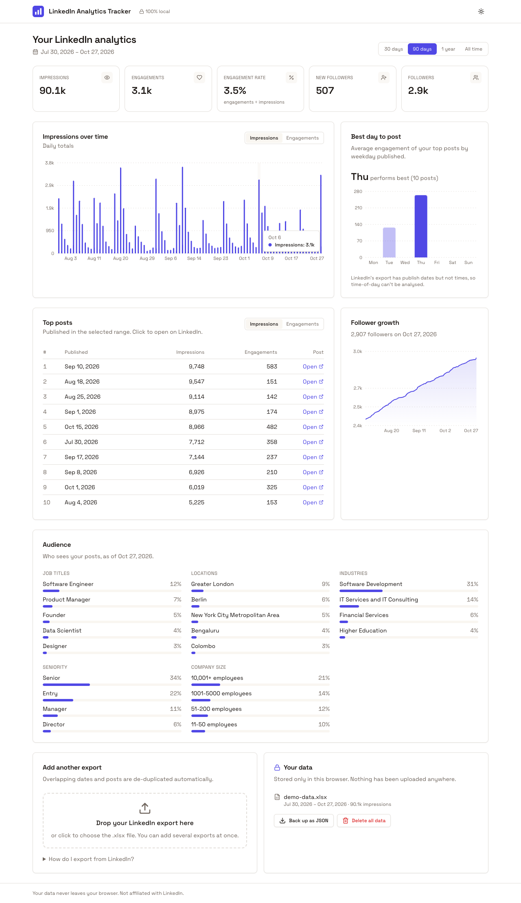
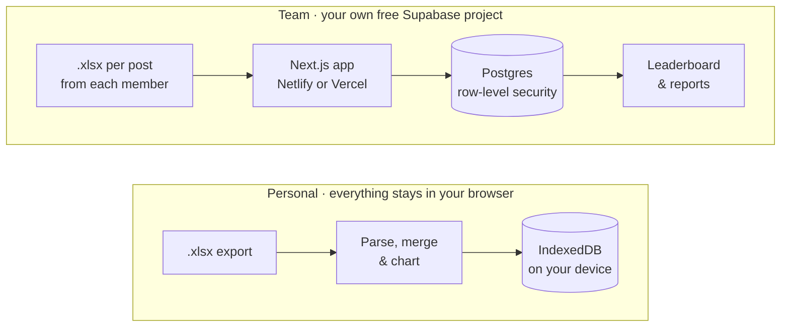
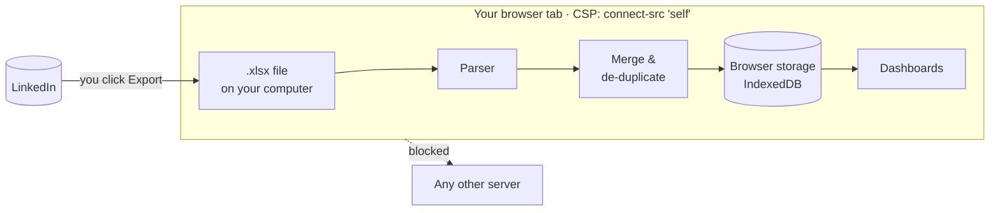
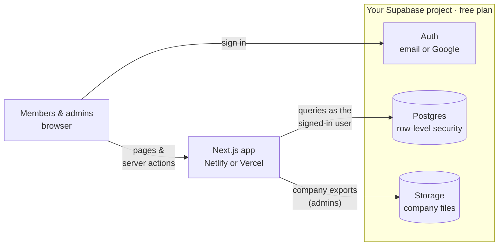
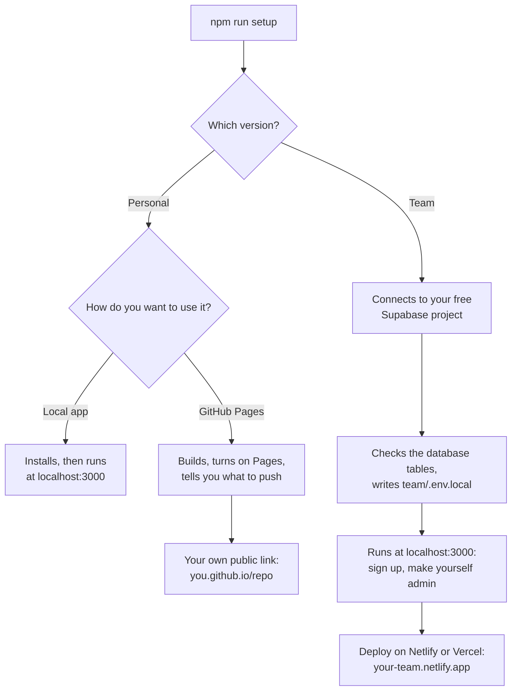
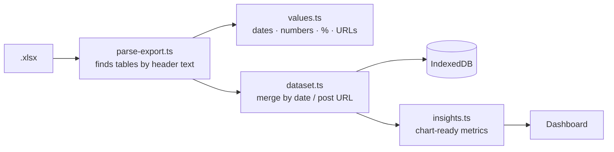
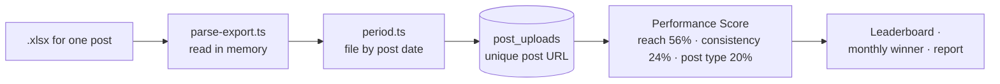

# LinkedIn Analytics Tracker

**Clear dashboards for your LinkedIn analytics, without the LinkedIn API.** Use it on your own,
privately in your browser, or run a free shared tracker for your whole team.

[](https://github.com/enlear/linkedin-analytics-tracker/actions/workflows/ci.yml)
[](LICENSE)

**▶ Try the personal version: [enlear.github.io/linkedin-analytics-tracker](https://enlear.github.io/linkedin-analytics-tracker/)**.
No sign-up needed; click *Try it with demo data* if you don't have an export yet.



<sub>Personal version, with the built-in synthetic demo data.</sub>

---

## Two versions

| | **Personal** | **Team** |
|---|---|---|
| **For** | Just you | Your organisation |
| **You upload** | Your LinkedIn analytics export | Each member uploads the analytics of each post |
| **You get** | Impressions, engagement, top posts, followers, audience | Leaderboard, monthly winner, team dashboard, printable reports, company page analytics |
| **Your data lives** | Only in your browser | In your own Supabase project |
| **Sign-in** | None | Email or Google |
| **Runs on** | Your computer or GitHub Pages | Supabase + Netlify or Vercel |
| **Cost** | Free | Free plans, no credit card |
| **Setup** | 2–5 minutes | 30–45 minutes ([guide](team/docs/setup.md)) |
| **Code** | [`personal/`](personal) | [`team/`](team) |



## Why

LinkedIn's post-analytics APIs are only available to approved partners. But LinkedIn already lets
**every member export their own analytics** as an `.xlsx` file. This project turns those files into
the dashboards LinkedIn doesn't show you. There's no scraping, no API keys and no browser
extension.

---

## Personal version

> 🔒 **Your data never leaves your browser.** Your LinkedIn export is read by JavaScript on your
> own device and stored only in your browser. There is no server, and a Content-Security-Policy
> stops the page from contacting any other site.

### What you get

- **Impressions & engagements over time**: daily, rolling up to weekly for long ranges
- **KPIs vs the previous period**: impressions, engagements, engagement rate, new followers, total followers
- **Top posts** by impressions or engagements, each linking to the post
- **Follower growth** curve
- **Audience**: job titles, locations, industries, seniority, company size
- **Best day to post**, from how your posts performed by weekday
- **History beyond one year**: add an export every few months; overlapping days and posts are de-duplicated
- **Your data, your control**: back up everything as JSON, or delete it in one click
- Light & dark mode, works on phones

### Get your LinkedIn export

1. Open LinkedIn **on desktop** and go to your profile.
2. In the **Analytics** section, open **Post impressions** (or **Show all analytics → Content**).
3. Pick a date range at the top — up to the **past 365 days**.
4. Click **Export**. LinkedIn downloads an `.xlsx` file.
5. Drop the file onto the app. Repeat every few months to build a longer history.

### How your data stays private



- **There is no server.** The app is a static website. Hosting it only delivers the code; there
  is nowhere to upload to.
- **Enforced by your browser.** The page ships a Content-Security-Policy with
  `connect-src 'self'`, so even a bug or a compromised dependency can't send your file anywhere.
  You can check it: open DevTools → Network and import a file; no request is made.
- **No third parties.** No analytics, no trackers, no external fonts or CDNs.
- **Stored only on your device**, in your browser's IndexedDB, until you click *Delete all data*.

---

## Team version

> 🏢 **Your team's data stays in your own database.** You create a free Supabase project; the app
> stores everything there, behind row-level security. A new install starts empty, and nobody else
> can see your data, including the authors of this project.

### What you get

- **Post uploads**: members upload each post's analytics export and tag its type. Files are
  validated and de-duplicated by post URL.
- **Live leaderboard and monthly winner**, ranked by a Performance Score that blends median reach,
  consistency and post type
- **Admin dashboard**: team totals, activity feed, every member's history
- **Printable monthly reports** with the winner, rankings and charts
- **Company page analytics**: LinkedIn and TikTok exports, plus optional Facebook and Instagram
  insights through Meta's API
- **Email or Google sign-in.** Admins are set with one line of SQL, so nobody can promote
  themselves.
- **Free to run**: Supabase, plus Netlify or Vercel, all on free plans

### Get a post's analytics

Each member does this for every post they want counted. It takes under a minute:

1. Open your LinkedIn post and click **View analytics**.
2. Click **Export**. LinkedIn downloads an `.xlsx` file for that post.
3. In the team app, open **Upload post**, pick the post type and drop the file in.

### How team data is protected



- **You own the database.** Everything lives in your Supabase project. This repository contains
  no data and talks to no service of ours.
- **The database enforces access.** Every query runs as the signed-in person, and row-level
  security decides what they can do. Members add and delete only their own posts, everyone sees
  the leaderboard, and company analytics are admin-only.
- **No master key in the app.** The browser only gets Supabase's publishable key. The app never
  uses the secret key that bypasses security rules.
- **Members' files aren't kept.** A post export is read in memory; only its numbers are saved.

---

## Set it up yourself

You need [Node.js 20+](https://nodejs.org) and Git. Then:

```bash
git clone https://github.com/enlear/linkedin-analytics-tracker.git
cd linkedin-analytics-tracker
npm run setup
```

The setup asks which version you want, then walks you through it:



### Personal, option 1: local app

Runs on your computer only. Nothing is published.

```bash
npm run setup -- local     # or manually:
cd personal && npm install && npm run dev
```

Open <http://localhost:3000>.

### Personal, option 2: your own free copy on GitHub Pages

1. **Fork** this repository on GitHub, then clone your fork.
2. Run `npm run setup -- pages`. It sets your app name, runs the tests, checks the site builds,
   and turns on GitHub Pages if the [GitHub CLI](https://cli.github.com) is signed in.
3. If Pages isn't on yet: **Settings → Pages → Build and deployment → Source: GitHub Actions**.
4. Commit and push to `main`. The [deploy workflow](.github/workflows/pages.yml) publishes the
   site to `https://<you>.github.io/linkedin-analytics-tracker/` in about two minutes.

Any other static host works too: `npm run build`, then upload the `personal/out/` folder.

| Personal setting | Where | Default |
|---|---|---|
| App name | `NEXT_PUBLIC_APP_NAME` in `personal/.env.local` (local) or `personal/.env.production` (Pages) | LinkedIn Analytics Tracker |
| Description | `NEXT_PUBLIC_APP_DESCRIPTION`, same files | Private LinkedIn analytics… |
| Logo | Replace `personal/public/logo.svg` and `personal/src/app/icon.svg` | Bar-chart mark |

`npm run setup` writes the app name for you. `.env.production` is committed on purpose so the
GitHub Pages build can read it; only put public settings there.

### Team

**Follow the step-by-step guide: [team/docs/setup.md](team/docs/setup.md).** It covers every
prerequisite and every click. In short:

| Step | Where | What |
|---|---|---|
| 1 | GitHub | Fork this repository |
| 2 | Supabase | Create a free project and run [the SQL file](team/supabase/migrations/20261028000000_initial_schema.sql) in the SQL Editor |
| 3 | Supabase | Allow `http://localhost:3000/**` as a redirect URL and choose how sign-up emails are sent |
| 4 | Your computer | `npm run setup -- team`, then sign up at <http://localhost:3000> |
| 5 | Supabase | `select public.make_admin('you@example.com');` |
| 6 | Netlify or Vercel | Import the repo (`team/` folder) with two environment variables |
| 7 | Supabase | Add your live address to the URL configuration, then invite your team |

| Free service | Used for | Good to know |
|---|---|---|
| [Supabase](https://supabase.com) | Database, sign-in, file storage | Free projects pause after a week without activity; the included [keep-alive workflow](.github/workflows/supabase-keepalive.yml) prevents it |
| [Netlify](https://netlify.com) | Hosting | Free plan allows commercial use |
| [Vercel](https://vercel.com) | Hosting (alternative) | Hobby plan is for non-commercial use only |
| [Resend](https://resend.com) or [Brevo](https://brevo.com) | Sign-up emails | Recommended; Supabase's built-in sender only reaches your own Supabase organisation |

---

## How it works

### Personal



LinkedIn's export has five sheets. The parser locates each section by its **header labels**, not
by cell positions, so renamed sheets, moved tables and extra rows still work.

| Sheet | What's read |
|---|---|
| DISCOVERY | Date range, total impressions, members reached |
| ENGAGEMENT | Impressions and engagements per day |
| TOP POSTS | Two side-by-side tables (by engagements, by impressions), merged on the post URL |
| FOLLOWERS | Total followers on the export date, new followers per day |
| DEMOGRAPHICS | Category, value and share of your audience |

It accepts US and European dates (`3/14/2025`, `14.03.2025`, `2025-03-14`, Excel date cells),
locale number formats (`1,234`, `1.234`, `1 234`) and percentages like `5%` or `< 1%`. Missing
sheets show a warning instead of failing, and a file that isn't a LinkedIn export gets a clear
message.

### Team



- **Report months** run from the 20th to the 19th (e.g. "May" = 20 Apr – 19 May). The winner is
  settled at the end of the calendar month, so a period's last posts still gather impressions
  before the result freezes.
- **The score** compares each member with that month's participants: median reach per post
  (one viral post can't dominate), number of posts, and the average weight of their post types.
  Admins set the weights in Settings.
- **Duplicates** are blocked by the database: a post URL can only be counted once across the team.

The in-app *Documentation* page explains scoring and periods with a worked example. Technical
details are in the [team README](team/README.md).

### Project layout

```
.
├── setup.mjs                    # interactive setup for both versions
├── personal/                    # browser-only app (Next.js, exported as a static site)
│   ├── src/lib/linkedin/        # export parser, value parsing, demo-data generator
│   ├── src/lib/dataset.ts       # merges several exports
│   ├── src/lib/insights.ts      # metrics for the charts (pure functions)
│   ├── src/components/          # dashboard and import UI
│   └── test/                    # unit tests with synthetic fixtures only
├── team/                        # team app (Next.js + Supabase)
│   ├── supabase/migrations/     # database: tables, row-level security, functions
│   ├── src/app/                 # pages and server actions
│   ├── src/lib/                 # parsers, scoring, tracking periods, Supabase clients
│   ├── docs/setup.md            # step-by-step setup guide
│   └── test/                    # unit tests and in-process database tests (PGlite)
├── netlify.toml                 # Netlify build for team/
└── .github/workflows/           # CI, GitHub Pages deploy, Supabase keep-alive
```

### Development

```bash
cd personal                  # or: cd team
npm install
npm run dev                  # http://localhost:3000 (team needs team/.env.local)
npm test                     # personal: parser, merging, insights
                             # team: parsers, scoring, and every database security rule
npm run lint && npm run typecheck
npm run build
```

The team tests need no Supabase project: the database migrations run in
[PGlite](https://pglite.dev), an in-process Postgres.

## FAQ

**Is this allowed by LinkedIn?** It only reads files LinkedIn gives you through its own Export
button. It doesn't scrape, automate the website or call private APIs. (The team version has an
optional, experimental sync through LinkedIn's official API, which needs LinkedIn's approval.)

**Which version should I use?** The personal one if it's just you: nothing to set up and nothing
leaves your browser. The team one if several people should be compared or reported on together.

**Does the team version really cost nothing?** For a typical team, yes. Supabase, Netlify, Resend
and Brevo all have free plans without a credit card. The [cost table](team/README.md#what-it-costs)
lists the limits.

**Can the authors see our team's data?** No. Your deployment talks only to your own Supabase
project. This repository contains no data and no analytics.

**What if LinkedIn changes the export?** Because tables are found by their headers, most layout
changes don't matter. If something breaks,
[report it](https://github.com/enlear/linkedin-analytics-tracker/issues/new?template=export_format.yml)
and describe the structure. Please never attach your file.

**My LinkedIn isn't in English.** Dates and numbers in all common formats are handled. Header
labels are included for a few languages; adding yours is a small PR (see
[CONTRIBUTING.md](CONTRIBUTING.md)).

**Can it show the best time of day to post?** LinkedIn's export has publish dates but not times,
so it shows the best weekday.

## Contributing

Contributions are welcome. See [CONTRIBUTING.md](CONTRIBUTING.md); a good place to start is
issues labelled
[`good first issue`](https://github.com/enlear/linkedin-analytics-tracker/labels/good%20first%20issue).

## License

[MIT](LICENSE) © Enlear. Not affiliated with, endorsed by, or sponsored by LinkedIn Corporation.
LinkedIn is a trademark of LinkedIn Corporation.
