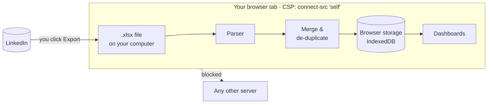
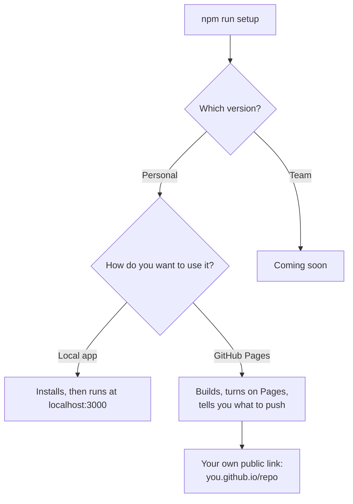
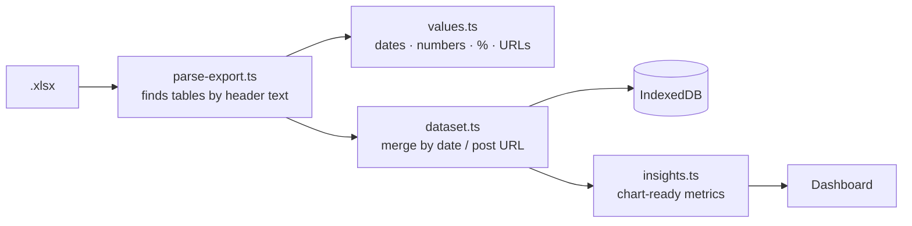

# LinkedIn Analytics Tracker

**Clear dashboards for your LinkedIn analytics, without the LinkedIn API and without uploading
your data anywhere.**

[](https://github.com/enlear/linkedin-analytics-tracker/actions/workflows/ci.yml)
[](LICENSE)

**▶ Try it: [enlear.github.io/linkedin-analytics-tracker](https://enlear.github.io/linkedin-analytics-tracker/)**.
No sign-up needed; click *Try it with demo data* if you don't have an export yet.

> 🔒 **Your data never leaves your browser.** Your LinkedIn export is read by JavaScript on your
> own device and stored only in your browser. There is no server, and a Content-Security-Policy
> stops the page from contacting any other site.


<sub>Screenshot uses the built-in synthetic demo data.</sub>

---

## Why

LinkedIn's post-analytics APIs are only available to approved partners. But LinkedIn already lets
**every member export their own analytics** as an `.xlsx` file. This app turns that file into the
dashboards LinkedIn doesn't show you. There's no scraping, no API keys and no browser extension.

## What you get

- **Impressions & engagements over time**: daily, rolling up to weekly for long ranges
- **KPIs vs the previous period**: impressions, engagements, engagement rate, new followers, total followers
- **Top posts** by impressions or engagements, each linking to the post
- **Follower growth** curve
- **Audience**: job titles, locations, industries, seniority, company size
- **Best day to post**, from how your posts performed by weekday
- **History beyond one year**: add an export every few months; overlapping days and posts are de-duplicated
- **Your data, your control**: back up everything as JSON, or delete it in one click
- Light & dark mode, works on phones

## Get your LinkedIn export

1. Open LinkedIn **on desktop** and go to your profile.
2. In the **Analytics** section, open **Post impressions** (or **Show all analytics → Content**).
3. Pick a date range at the top — up to the **past 365 days**.
4. Click **Export**. LinkedIn downloads an `.xlsx` file.
5. Drop the file onto the app. Repeat every few months to build a longer history.

## How your data stays private



- **There is no server.** The app is a static website. Hosting it only delivers the code; there
  is nowhere to upload to.
- **Enforced by your browser.** The page ships a Content-Security-Policy with
  `connect-src 'self'`, so even a bug or a compromised dependency can't send your file anywhere.
  You can check it: open DevTools → Network and import a file; no request is made.
- **No third parties.** No analytics, no trackers, no external fonts or CDNs.
- **Stored only on your device**, in your browser's IndexedDB, until you click *Delete all data*.

---

## Set it up yourself

You need [Node.js 20+](https://nodejs.org) and Git. Then:

```bash
git clone https://github.com/enlear/linkedin-analytics-tracker.git
cd linkedin-analytics-tracker
npm run setup
```

The setup asks two questions:



### Option 1: Local app

Runs on your computer only. Nothing is published.

```bash
npm run setup -- local     # or manually:
cd personal && npm install && npm run dev
```

Open <http://localhost:3000>.

### Option 2: Your own free copy on GitHub Pages

1. **Fork** this repository on GitHub, then clone your fork.
2. Run `npm run setup -- pages`. It sets your app name, runs the tests, checks the site builds,
   and turns on GitHub Pages if the [GitHub CLI](https://cli.github.com) is signed in.
3. If Pages isn't on yet: **Settings → Pages → Build and deployment → Source: GitHub Actions**.
4. Commit and push to `main`. The [deploy workflow](.github/workflows/pages.yml) publishes the
   site to `https://<you>.github.io/linkedin-analytics-tracker/` in about two minutes.

Any other static host works too: `npm run build`, then upload the `personal/out/` folder.

### Settings

| Setting | Where | Default |
|---|---|---|
| App name | `NEXT_PUBLIC_APP_NAME` in `personal/.env.local` (local) or `personal/.env.production` (Pages) | LinkedIn Analytics Tracker |
| Description | `NEXT_PUBLIC_APP_DESCRIPTION`, same files | Private LinkedIn analytics… |
| Logo | Replace `personal/public/logo.svg` and `personal/src/app/icon.svg` | Bar-chart mark |

`npm run setup` writes the app name for you. `.env.production` is committed on purpose so the
GitHub Pages build can read it; only put public settings there.

---

## How it works



LinkedIn's export has five sheets. The parser locates each section by its **header labels**, not
by cell positions, so renamed sheets, moved tables and extra rows still work.

| Sheet | What's read |
|---|---|
| DISCOVERY | Date range, total impressions, members reached |
| ENGAGEMENT | Impressions and engagements per day |
| TOP POSTS | Two side-by-side tables (by engagements, by impressions), merged on the post URL |
| FOLLOWERS | Total followers on the export date, new followers per day |
| DEMOGRAPHICS | Category, value and share of your audience |

It accepts US and European dates (`3/14/2025`, `14.03.2025`, `2025-03-14`, Excel date cells),
locale number formats (`1,234`, `1.234`, `1 234`) and percentages like `5%` or `< 1%`. Missing
sheets show a warning instead of failing, and a file that isn't a LinkedIn export gets a clear
message.

### Project layout

```
.
├── setup.mjs                  # interactive setup
├── personal/                  # the app (Next.js, exported as a static site)
│   ├── src/lib/linkedin/      # export parser, value parsing, demo-data generator
│   ├── src/lib/dataset.ts     # merges several exports
│   ├── src/lib/insights.ts    # metrics for the charts (pure functions)
│   ├── src/components/        # dashboard and import UI
│   └── test/                  # unit tests with synthetic fixtures only
└── .github/workflows/         # CI and GitHub Pages deploy
```

### Development

```bash
cd personal
npm install
npm run dev          # http://localhost:3000
npm test             # parser, merging, insights
npm run lint && npm run typecheck
npm run build        # static site in personal/out
```

## FAQ

**Is this allowed by LinkedIn?** It only reads files LinkedIn gives you through its own Export
button. It doesn't scrape, automate the website or call private APIs.

**What if LinkedIn changes the export?** Because tables are found by their headers, most layout
changes don't matter. If something breaks,
[report it](https://github.com/enlear/linkedin-analytics-tracker/issues/new?template=export_format.yml)
and describe the structure. Please never attach your file.

**My LinkedIn isn't in English.** Dates and numbers in all common formats are handled. Header
labels are included for a few languages; adding yours is a small PR (see
[CONTRIBUTING.md](CONTRIBUTING.md)).

**Can it show the best time of day to post?** LinkedIn's export has publish dates but not times,
so it shows the best weekday.

**Is there a version for teams?** A self-hostable team version with shared dashboards and
leaderboards is in progress.

## Contributing

Contributions are welcome. See [CONTRIBUTING.md](CONTRIBUTING.md); a good place to start is
issues labelled
[`good first issue`](https://github.com/enlear/linkedin-analytics-tracker/labels/good%20first%20issue).

## License

[MIT](LICENSE) © Enlear. Not affiliated with, endorsed by, or sponsored by LinkedIn Corporation.
LinkedIn is a trademark of LinkedIn Corporation.
