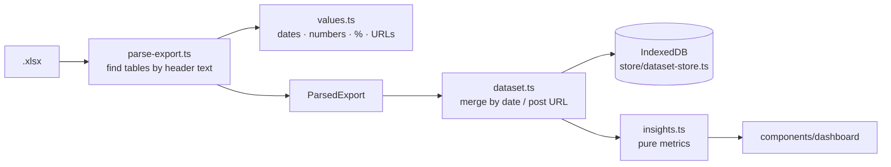

# Personal version

Browser-only dashboard for your own LinkedIn analytics export. See the
[main README](../README.md) for features, the export steps and the privacy model.

```bash
npm install
npm run dev        # http://localhost:3000
npm test           # vitest — parser, merging, insights
npm run build      # static site in ./out
```

## How it's built



| File | Responsibility |
|---|---|
| `src/lib/linkedin/parse-export.ts` | Reads the workbook. Each section (summary, daily, top posts, followers, demographics) is located by header labels in `LABELS`, in the sheet whose name matches first and then in every other sheet. Missing sections become warnings; unrelated files get a clear error. |
| `src/lib/linkedin/values.ts` | Locale-tolerant parsing: `1,234` / `1.234` / `1 234`, `5%` / `< 1%`, M/D vs D/M dates (detected once per workbook), Excel serial dates. |
| `src/lib/linkedin/build-export.ts` | Writes a workbook in LinkedIn's layout. Powers the demo button and the test fixtures, so the demo goes through the real parser. |
| `src/lib/dataset.ts` | Merges exports: daily rows by date (newer wins), posts by URL (max metric), latest demographics snapshot. |
| `src/lib/insights.ts` | Date windows, totals, weekly roll-up, follower curve, weekday performance. |
| `src/app/layout.tsx` | Production Content-Security-Policy (`connect-src 'self'`) — the privacy guarantee. |

## Configuration

Variables are inlined at build time. Put them in `.env.local` for local use, or in
`.env.production` (committed) for the GitHub Pages build. `npm run setup` writes the app name for you.

| Variable | Purpose |
|---|---|
| `NEXT_PUBLIC_APP_NAME` | App name in the header and page title |
| `NEXT_PUBLIC_APP_DESCRIPTION` | Meta description |
| `NEXT_PUBLIC_REPO_URL` | "Source code" link in the footer (the Pages workflow sets it) |
| `NEXT_PUBLIC_BASE_PATH` | Sub-path when hosted under `/repo-name` (the Pages workflow sets it) |
