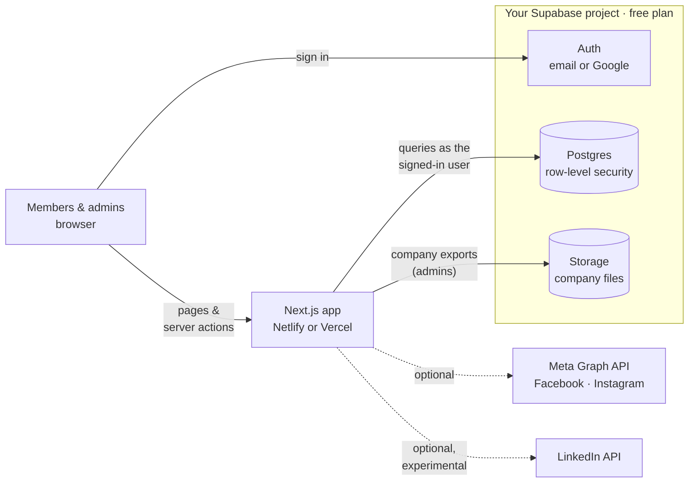
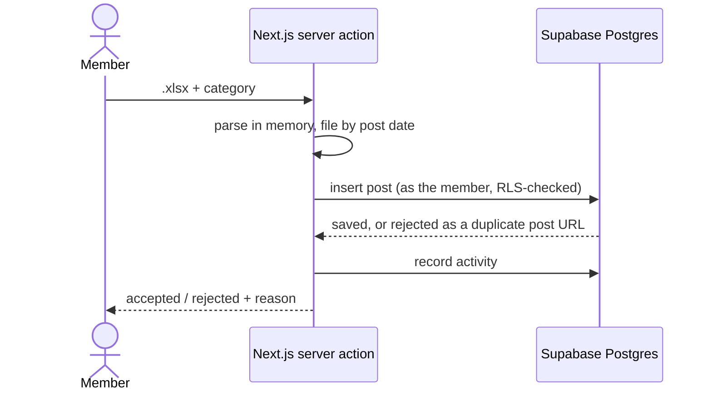

# Team version

A self-hosted LinkedIn tracker for organisations. Members upload the analytics of each post they
publish; admins get a team dashboard, a live leaderboard, monthly winners and printable reports.

It runs entirely on **free plans**: [Supabase](https://supabase.com) for the database, sign-in and
file storage, and [Netlify](https://netlify.com) or [Vercel](https://vercel.com) to host the app.
None of them asks for a credit card. A new install starts **empty**, and your data lives only in
your own Supabase project.

**→ Step-by-step setup guide: [docs/setup.md](docs/setup.md)** (30–45 minutes the first time)

- [What's inside](#whats-inside)
- [How it fits together](#how-it-fits-together)
- [What it costs](#what-it-costs)
- [Setup in short](#setup-in-short)
- [Configuration reference](#configuration-reference)
- [Development](#development)

## What's inside

| Area | Who | What it does |
|---|---|---|
| **Upload post** | Members | Upload a LinkedIn *single-post* analytics `.xlsx` and pick its category. Validated, de-duplicated by post URL. |
| **Dashboard** | Everyone | Members see their own trend; admins see team totals, live leaderboard, activity feed. |
| **Standings** | Members | Where you rank this month and all-time. |
| **Employee list** | Admins | Every member with their history; remove a member and all their data. |
| **Monthly report** | Admins | Printable report with the month's winner, rankings and charts. |
| **Company analytics** | Admins | Monthly uploads for the company page (LinkedIn, TikTok) and optional Facebook/Instagram insights. |
| **Settings** | Everyone | Your account. Admins also manage post categories, their scoring weights and the Meta (Facebook/Instagram) connection. |
| **Documentation** | Admins | In-app docs for scoring, tracking periods and upload validation. |

**Roles.** Everyone who signs up is a *member*. An admin is a user whose Supabase
`app_metadata.role` is `admin`. Only the database owner can set that, with one line of SQL, so
nobody can make themselves admin through the app. Admins run the tracker and don't appear on
leaderboards.

**Tracking periods.** A report month runs from the 20th of the previous month to the 19th
(e.g. "May" = 20 Apr – 19 May). Uploads are never blocked, and the winner freezes at the end of
the report month. See *Documentation → Tracking periods* in the app.

## How it fits together



The browser only ever holds the **publishable** Supabase key. Every query runs as the signed-in
user, so the row-level security policies in [`supabase/migrations/`](supabase/migrations) are the
access control:

| Data | Members | Admins |
|---|---|---|
| Their own posts | Read, add, delete | — |
| Everyone's posts and the leaderboard | Read | Read, delete |
| Upload activity | Their own | Everyone's |
| Post categories | Read | Manage |
| Company analytics and original files | — | Manage |
| Meta access token | — | Used by the server only; the app never sends it to a browser |

The app doesn't use Supabase's secret (service role) key at all.

### How an upload flows



The member's file is never stored. Only the extracted numbers are saved.

## What it costs

Nothing, for a typical team.

| Service | Free plan covers | Watch out for |
|---|---|---|
| **Supabase** | 500 MB database, 1 GB file storage, 50,000 monthly active users ([current limits](https://supabase.com/pricing)) | Free projects **pause after a week with no activity**. Restoring takes one click, and the included keep-alive workflow prevents it. The built-in email sender only reaches your Supabase organisation, so add free SMTP before inviting the team ([how](docs/setup.md#5b-choose-how-sign-up-emails-are-sent)). |
| **Netlify Free** | Hosting, HTTPS, deploys on every push; commercial use allowed | A monthly usage allowance. A team tracker uses a small fraction of it. |
| **Vercel Hobby** | Hosting, HTTPS, deploys on every push | **Personal, non-commercial** use only. For a company deployment, use Netlify or Vercel Pro. |
| **Resend or Brevo** (optional) | Enough free emails for sign-up confirmations | Needs a domain whose DNS you can edit. |

A whole year of a 50-person team's uploads is a few megabytes of database.

## Setup in short

Every click is in **[docs/setup.md](docs/setup.md)**. In short:

1. Create a free Supabase project and run
   [`supabase/migrations/20261028000000_initial_schema.sql`](supabase/migrations/20261028000000_initial_schema.sql)
   in its SQL Editor.
2. Add `http://localhost:3000/**` under **Authentication → URL Configuration → Redirect URLs**, and
   choose how sign-up emails are sent.
3. From the repository root, run `npm run setup` and choose **Team**. Sign up at
   <http://localhost:3000>.
4. Make yourself admin in the SQL Editor: `select public.make_admin('you@example.com');`
5. Deploy `team/` to Netlify or Vercel with `NEXT_PUBLIC_SUPABASE_URL` and
   `NEXT_PUBLIC_SUPABASE_PUBLISHABLE_KEY`, then add the live address to Supabase's URL
   configuration.

**Optional:** Google sign-in, Facebook and Instagram insights, and the experimental LinkedIn API
sync are covered in the [guide](docs/setup.md#optional-integrations).

**Updating:** when a new version adds a file to `supabase/migrations/`, run each new file in the
SQL Editor, oldest first, before deploying the new code.

## Configuration reference

All settings are environment variables: `team/.env.local` for local development, your host's
environment variables for deployments. Values starting with `NEXT_PUBLIC_` are built into the app,
so redeploy after changing them.

| Variable | Default | Purpose |
|---|---|---|
| `NEXT_PUBLIC_SUPABASE_URL` | — (required) | Your Supabase project URL |
| `NEXT_PUBLIC_SUPABASE_PUBLISHABLE_KEY` | — (required) | Publishable key (`sb_publishable_…`). Public by design |
| `NEXT_PUBLIC_APP_NAME` | LinkedIn Analytics Tracker | Name in the sidebar, login page, reports, installed-app name |
| `NEXT_PUBLIC_APP_SHORT_NAME` | LI Tracker | Name under the home-screen icon |
| `NEXT_PUBLIC_APP_DESCRIPTION` | Track your team's… | Login page tagline, meta description |
| `NEXT_PUBLIC_LOGO_URL` | `/logo.svg` | Your logo: put a file in `public/` or use an absolute URL |
| `APP_TIMEZONE` | `UTC` | IANA timezone for "today", deadlines and month boundaries |
| `LINKEDIN_API_ENABLED` | `false` | Experimental LinkedIn API sync ([guide](docs/linkedin-member-analytics-setup.md)) |
| `NEXT_PUBLIC_FEATURE_LINKEDIN_API` | `false` | Shows the "Connect LinkedIn" UI |

Sign-in options (email, Google, open or closed sign-up) are switched in the Supabase dashboard,
not here. The login page follows them within five minutes, with no redeploy.

## Development

```bash
npm install
npm run dev       # http://localhost:3000 (needs team/.env.local)
npm run lint
npm run typecheck
npm test          # unit tests + the database: migrations and every RLS policy, in PGlite
npm run build
```

`npm test` needs no Supabase project. The migrations run in [PGlite](https://pglite.dev), an
in-process Postgres, with small stand-ins for Supabase's `auth` and `storage` schemas
([`test/db/harness.ts`](test/db/harness.ts)). Each policy is then exercised as a member and as an
admin.

| Folder | What's in it |
|---|---|
| `supabase/migrations/` | The database: tables, row-level security, functions, storage bucket |
| `src/app/` | Pages and server actions (uploads, company imports, Meta, LinkedIn, admin tools) |
| `src/lib/data/` | Typed readers for the Supabase tables |
| `src/lib/linkedin/` | Single-post export parser |
| `src/lib/company-import/` | LinkedIn company-page and TikTok export parsers |
| `src/lib/period.ts` | Tracking periods and the Performance Score |
| `src/lib/supabase/` | Supabase clients, database types, paging helper |
| `test/` | Unit tests and the PGlite database tests, synthetic data only |
