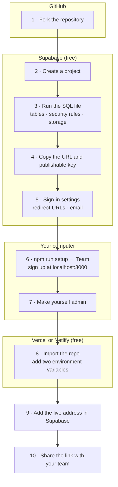

# Team version: setup guide

This guide takes you from nothing to a live team tracker your colleagues can sign up to. Allow
**30–45 minutes** the first time. Every service below has a free plan, and none of them asks for a
credit card.

You end up with your own private copy: your own database, your own sign-in and your own web
address. It starts **empty**: no members, no posts and no company data. The only rows created for
you are four starter post categories, which you can rename, re-weight or archive.



- [Before you start](#before-you-start)
- [1. Get your own copy of the code](#1-get-your-own-copy-of-the-code)
- [2. Create a Supabase project](#2-create-a-supabase-project)
- [3. Create the tables](#3-create-the-tables)
- [4. Copy the project URL and key](#4-copy-the-project-url-and-key)
- [5. Set up sign-in](#5-set-up-sign-in)
- [6. Run it on your computer](#6-run-it-on-your-computer)
- [7. Make yourself an admin](#7-make-yourself-an-admin)
- [8. Deploy](#8-deploy)
- [9. Tell Supabase your live address](#9-tell-supabase-your-live-address)
- [10. Invite your team](#10-invite-your-team)
- [11. Keep the free project awake](#11-keep-the-free-project-awake)
- [Optional integrations](#optional-integrations)
- [Updating to a new version](#updating-to-a-new-version)
- [Troubleshooting](#troubleshooting)

## Before you start

| You need | What it's for | Required? |
|---|---|---|
| A [GitHub](https://github.com) account | Holds your copy of the code. Vercel and Netlify deploy from it | Yes |
| [Node.js 20+](https://nodejs.org) and [Git](https://git-scm.com) | Running the setup script and the app on your computer. Check with `node -v` | Yes |
| A [Supabase](https://supabase.com) account | Database, sign-in and file storage. Sign in with GitHub | Yes |
| A [Vercel](https://vercel.com) **or** [Netlify](https://netlify.com) account | Hosting the app at a public address | Yes, to share it |
| An email-sending service ([Resend](https://resend.com) or [Brevo](https://brevo.com)) and a domain whose DNS you can edit | Sign-up confirmation and password-reset emails to anyone | Recommended ([alternatives](#5b-choose-how-sign-up-emails-are-sent)) |
| A [Google Cloud](https://console.cloud.google.com) account | A **Continue with Google** button | Optional |
| A [Meta developer](https://developers.facebook.com/apps/) app | Facebook and Instagram company insights | Optional |
| A [LinkedIn developer](https://www.linkedin.com/developers/apps) app with partner approval | Automatic post syncing (experimental) | Optional |

> **Vercel or Netlify?** Vercel's free Hobby plan is for **personal, non-commercial** use. If the
> tracker is for a company, use Netlify, whose free plan allows commercial use, or a paid Vercel
> plan.

## 1. Get your own copy of the code

**Fork** this repository on GitHub (the **Fork** button, top right), then clone your fork:

```bash
git clone https://github.com/<you>/linkedin-analytics-tracker.git
cd linkedin-analytics-tracker
```

<details>
<summary>Want your copy to be private?</summary>

A fork of a public repository is always public. To keep your copy private, create an **empty
private repository** on GitHub, then:

```bash
git clone https://github.com/enlear/linkedin-analytics-tracker.git
cd linkedin-analytics-tracker
git remote rename origin upstream
git remote add origin https://github.com/<you>/<your-private-repo>.git
git push -u origin main
```

Your code doesn't contain any secrets either way. The settings live in your host and in Supabase,
not in the repository.

</details>

## 2. Create a Supabase project

1. Go to [supabase.com/dashboard](https://supabase.com/dashboard) and sign in.
2. Click **New project**. If asked, create an **organisation** on the **Free** plan first.
3. Fill in:
   - **Project name**: anything, e.g. `linkedin-tracker`.
   - **Database password**: click **Generate a password** and save it in your password manager.
     The app never needs it; it's only for connecting database tools directly.
   - **Region**: the one closest to your team.
4. Click **Create new project** and wait a minute or two until the dashboard says it's ready.

The free plan includes two active projects.

## 3. Create the tables

1. Open **SQL Editor** in the left sidebar, then **New query**
   ([direct link](https://supabase.com/dashboard/project/_/sql/new)).
2. Open [`team/supabase/migrations/20261028000000_initial_schema.sql`](../supabase/migrations/20261028000000_initial_schema.sql),
   copy **all** of it and paste it into the editor.
3. Click **Run**. You should see *Success. No rows returned*.
   If the editor warns about a **destructive operation**, that's the `drop policy if exists`
   lines that let the script be run again safely. Confirm and run.

Check that it worked:

- **Table Editor** lists tables such as `employees`, `post_uploads` and `post_categories`.
- `post_categories` has four rows: Article, Direct post, Event update and Other. Every other table
  is empty.
- **Storage** has a private bucket called `company-uploads`.

| The script creates | Why |
|---|---|
| Tables for members, posts, activity, categories and company analytics | Everything the app stores |
| Row-level security policies | The access rules. Members only change their own posts, and company data is admin-only |
| A few database functions | Atomic company imports, member removal, `make_admin`, and the keep-alive `ping` |
| A private `company-uploads` storage bucket | Original company export files, admins only |
| Four starter post categories | So members can upload straight away |

Running the script again is safe: it never deletes data or overwrites your category edits.

## 4. Copy the project URL and key

Click **Connect** at the top of the project page, or open **Project Settings → API Keys**
([direct link](https://supabase.com/dashboard/project/_/settings/api-keys)). You need:

- The **Project URL**, like `https://abcdefghijklmnop.supabase.co`.
- The **Publishable key**, starting with `sb_publishable_`. If you only see a **Create new API
  keys** button, click it. Supabase is retiring the older `anon` key, so use the publishable one.

Both values are public by design: the browser needs them, and the row-level security policies
decide what each person can see.

> **Never** use the **secret** key (`sb_secret_…`, or the legacy `service_role` key) anywhere in
> this app. It bypasses every security rule, and the app doesn't need it.

## 5. Set up sign-in

### 5a. Allow the app's address

Open **Authentication → URL Configuration**
([direct link](https://supabase.com/dashboard/project/_/auth/url-configuration)):

- **Site URL**: `http://localhost:3000` for now. You'll change it to your live address in
  [step 9](#9-tell-supabase-your-live-address).
- **Redirect URLs** → **Add URL**: `http://localhost:3000/**`

Confirmation links and Google sign-in return to these addresses. Supabase refuses to redirect
anywhere that isn't listed.

### 5b. Choose how sign-up emails are sent

New members confirm their email address with a link. Supabase's **built-in email sender only
delivers to members of your Supabase organisation**, and only a few emails an hour. Anyone else
gets an `Email address not authorized` error. That's fine for testing on your own, but before you
invite the team, pick one of these options.

#### Option A: free SMTP (recommended)

**With [Resend](https://resend.com):**

1. Sign up, open **Domains → Add domain** and enter a domain you control, e.g.
   `mail.yourcompany.com`.
2. Add the DNS records Resend shows at your DNS provider. Wait until the domain shows
   **Verified**, usually a few minutes.
3. Open **API Keys → Create API key** with *Sending access*. Copy the key.
4. In Supabase, open **Authentication → Emails → SMTP Settings**
   ([direct link](https://supabase.com/dashboard/project/_/auth/smtp)), turn on **Enable custom
   SMTP** and fill in:

   | Field | Value |
   |---|---|
   | Sender email | `no-reply@mail.yourcompany.com` (any address on the verified domain) |
   | Sender name | Your app's name |
   | Host | `smtp.resend.com` |
   | Port | `465` |
   | Username | `resend` |
   | Password | The API key from step 3 |

**With [Brevo](https://brevo.com):** verify your sender domain, then open **SMTP & API → SMTP**
and generate an SMTP key. Use host `smtp-relay.brevo.com`, port `587`, the **SMTP login** shown on
that page as the username, and the SMTP key as the password.

After you switch to custom SMTP, Supabase allows **30 emails an hour** to start with. If you're
inviting more people than that at once, raise it under **Authentication → Rate Limits**
([direct link](https://supabase.com/dashboard/project/_/auth/rate-limits)).

#### Option B: Google sign-in only

Set up [Google sign-in](#google-sign-in). Google has already confirmed the address, so no email is
sent. To hide the email form so everyone uses Google, turn off the **Email** provider under
**Authentication → Sign In / Providers**. The login page picks up the change within five minutes.

#### Option C: skip email confirmation

Under **Authentication → Sign In / Providers → Email**, turn off **Confirm email**. Sign-up works
instantly, but nobody checks that an address is real. Only do this if you share the link privately.

## 6. Run it on your computer

From the repository root:

```bash
npm run setup
```

Choose **2) Team**. The script:

1. Asks for the Project URL and publishable key, and checks they work.
2. Asks for the app name, a one-line description and the timezone used for monthly periods.
3. Checks that the tables from step 3 exist. If not, it shows a link to the SQL Editor and waits.
4. Writes `team/.env.local` and installs dependencies.
5. Offers to start the app.

<details>
<summary>Prefer to do it by hand?</summary>

```bash
cd team
cp .env.example .env.local   # then paste your URL and publishable key into it
npm install
npm run dev
```

</details>

Open <http://localhost:3000>, click **Sign up**, and create an account with the email address you
want to be admin. Confirm the email, then sign in. You'll see an empty member dashboard.

## 7. Make yourself an admin

Back in the Supabase **SQL Editor**, run this with your own email address:

```sql
select public.make_admin('you@yourcompany.com');
```

It answers `you@yourcompany.com is now an admin`. **Sign out and back in**: the sidebar now shows
the admin pages: Company analytics, Employee list, Monthly report and Documentation.

Admins run the tracker but don't take part: they don't upload posts or appear on leaderboards. If
you also want to compete, sign up a second time with another address.

Only the database owner can make admins, through this SQL function. Nobody can make themselves
admin from the app. To make someone an admin later, they sign up first, then you run the same line
with their address.

<details>
<summary>Removing an admin</summary>

```sql
update auth.users
   set raw_app_meta_data = raw_app_meta_data - 'role'
 where lower(email) = lower('them@yourcompany.com');
```

It takes effect when they next sign in, or within an hour when their session refreshes.

</details>

## 8. Deploy

Pick one host. Both build straight from your GitHub repository and redeploy on every push to
`main`.

You'll add these **environment variables** to the host:

| Variable | Value |
|---|---|
| `NEXT_PUBLIC_SUPABASE_URL` | Your Project URL from step 4 |
| `NEXT_PUBLIC_SUPABASE_PUBLISHABLE_KEY` | Your publishable key from step 4 |
| `NEXT_PUBLIC_APP_NAME`, `APP_TIMEZONE`, … | Optional. Copy any others from `team/.env.local` ([full list](../README.md#configuration-reference)) |

### Netlify

1. In Netlify: **Add new project → Import an existing project → GitHub**, and pick your repository.
2. Netlify reads [`netlify.toml`](../../netlify.toml), which points the build at the `team/`
   folder. Leave the build settings as they are.
3. Under **Environment variables**, add the variables above.
4. Click **Deploy**. When it finishes, Netlify shows your address, e.g.
   `https://your-tracker.netlify.app`.

### Vercel

1. Go to [vercel.com/new](https://vercel.com/new) and import your repository.
2. Next to **Root Directory**, click **Edit** and choose `team`. Vercel detects Next.js.
3. Open **Environment Variables** and add the variables above.
4. Click **Deploy**. Your address looks like `https://your-tracker.vercel.app`.

Values starting with `NEXT_PUBLIC_` are built into the app, so **redeploy after changing them**.

## 9. Tell Supabase your live address

Back in **Authentication → URL Configuration**:

- Change **Site URL** to your live address, e.g. `https://your-tracker.netlify.app`.
- Under **Redirect URLs**, add `https://your-tracker.netlify.app/**`. Keep the localhost entry if
  you'll keep developing locally.

If you later add a custom domain, add it here too.

## 10. Invite your team

Share the live address. Each person clicks **Sign up**, confirms their email (or uses Google), and
can upload their first post straight away.

Things to do as admin before the first month ends:

- **Settings → Post categories**: check the starter categories and their weights. The weights feed
  the Performance Score.
- **Documentation** in the sidebar explains scoring, tracking periods and upload rules. Share it
  with the team.

Once everyone has joined, you can close sign-ups: **Authentication → Sign In / Providers →** turn
off **Allow new users to sign up**. The **Sign up** link disappears from the login page within
five minutes.

## 11. Keep the free project awake

Free Supabase projects **pause after a week with no activity**. A team that uploads every week
never hits this. To cover holidays, the repository includes a workflow that pings the database
every three days:

1. In your GitHub repository: **Settings → Secrets and variables → Actions → Variables** tab →
   **New repository variable**.
2. Add `SUPABASE_URL` (your Project URL) and `SUPABASE_PUBLISHABLE_KEY` (your publishable key).
   Both are public values, so variables are fine; they don't need to be secrets.
3. Open the **Actions** tab, choose **Keep the team database awake** and click **Run workflow**
   once to check it goes green.

If the project does pause, open it in the Supabase dashboard and click **Restore project**. No
data is lost.

## Optional integrations

### Google sign-in

1. In the [Google Cloud console](https://console.cloud.google.com), create a project (or pick one).
2. Open **Google Auth Platform** (formerly *OAuth consent screen*) and set it up: app name, support
   email and contact email.
   - **Audience → Internal** limits sign-in to your Google Workspace domain. That's a good fit for a
     company tracker, and it's only offered if you use Google Workspace.
   - **External** lets any Google account sign in.
3. Open **Clients → Create client → Web application**. Under **Authorised redirect URIs**, add
   `https://<your-project-ref>.supabase.co/auth/v1/callback`. Supabase shows this exact URL on
   its Google provider page. Click **Create** and copy the **Client ID** and **Client secret**.
4. In Supabase, open **Authentication → Sign In / Providers → Google**
   ([direct link](https://supabase.com/dashboard/project/_/auth/providers)), turn it on, paste the
   client ID and secret, and save.

**Continue with Google** appears on the login page within five minutes, with no redeploy.

### Facebook and Instagram company insights

For admins who also track the company's Facebook Page and its linked Instagram Business account:

1. Create an app at [developers.facebook.com/apps](https://developers.facebook.com/apps/).
2. In the [Graph API Explorer](https://developers.facebook.com/tools/explorer/), generate a **Page
   access token** with `pages_read_engagement`, `read_insights` and `pages_show_list`, plus
   `instagram_basic` and `instagram_manage_insights` for Instagram. Exchange it for a
   **long-lived** token so it doesn't expire after an hour.
3. In the app, open **Settings → Facebook connection** and paste the Page ID and token. The form
   has the exact steps for finding the IDs.

The token is stored in your database. Members can't read it, and the app only uses it on the
server, so it's never sent back to a browser. Skip this section if you only track LinkedIn.

### LinkedIn API sync (experimental)

Members can connect their LinkedIn account so their post analytics sync automatically. This needs
**Community Management API approval from LinkedIn**: a registered company and an app review. It
stays switched off until you set both feature flags. Full guide:
[linkedin-member-analytics-setup.md](linkedin-member-analytics-setup.md).

## Updating to a new version

1. Pull the new code. For a fork, use **Sync fork** on GitHub. For a private copy, run
   `git pull upstream main`.
2. If the update adds files to `team/supabase/migrations/`, run each new file in the SQL Editor,
   oldest first. Release notes say when this is needed.
3. Push to `main`. Your host redeploys automatically.

## Troubleshooting

| What you see | What to do |
|---|---|
| *Supabase isn't configured* (an error page, or a failed build) | The host is missing `NEXT_PUBLIC_SUPABASE_URL` or `NEXT_PUBLIC_SUPABASE_PUBLISHABLE_KEY`. Add both and redeploy. |
| *Email address not authorized* when signing up | You're on Supabase's built-in email sender. Pick an option from [step 5b](#5b-choose-how-sign-up-emails-are-sent). |
| *Email rate limit exceeded* | Too many sign-ups in an hour. Raise the limit under **Authentication → Rate Limits** (custom SMTP only), or wait an hour. |
| The confirmation email links to `localhost:3000` | **Site URL** still points at localhost. Do [step 9](#9-tell-supabase-your-live-address). |
| After clicking an email link: *That link couldn't be completed in this browser* | The address isn't in **Redirect URLs**, or the link was already used. Fix the URL list, then sign in, or ask for a new link from the login page. |
| Google says `redirect_uri_mismatch` | The redirect URI in Google Cloud must be your Supabase callback (`https://<ref>.supabase.co/auth/v1/callback`), not your app's address. |
| *Could not find the table … in the schema cache*, or the setup script waiting for the tables | The SQL from [step 3](#3-create-the-tables) hasn't run in **this** project. Check you're in the right project, then run it. |
| `make_admin` says *No user with email …* | Sign up in the app with that address first. Check the spelling. |
| Admin pages don't appear after `make_admin` | Sign out and back in. |
| The site is down and Supabase shows **Paused** | Click **Restore project**, then set up [step 11](#11-keep-the-free-project-awake). |
| *That file is over 4 MB* when uploading a post | LinkedIn's single-post exports are far smaller, so check it's the right file. Company exports have the same 4 MB cap. |
